<h1 align="center">HAL 9000 Media Command Center</h1>

  <strong>with Siri voice activation</strong>  
  Your home media setup, run from the couch, with HAL 9000 in charge. 
  Search Usenet, download or stream straight to the TV, and keep an eye on the PC and the network, 
  from your phone, your TV, your Windows desktop, or just by asking Siri.

  
  
  
  
  

  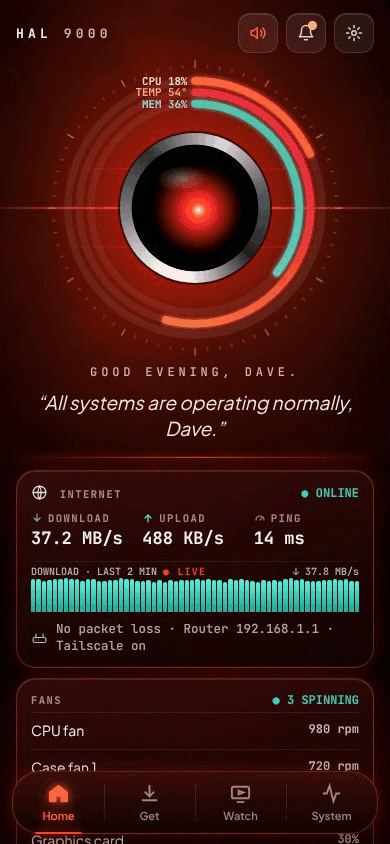
  &nbsp;
  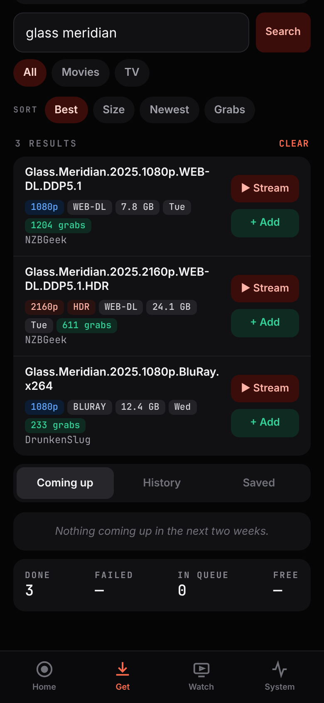
  &nbsp;
  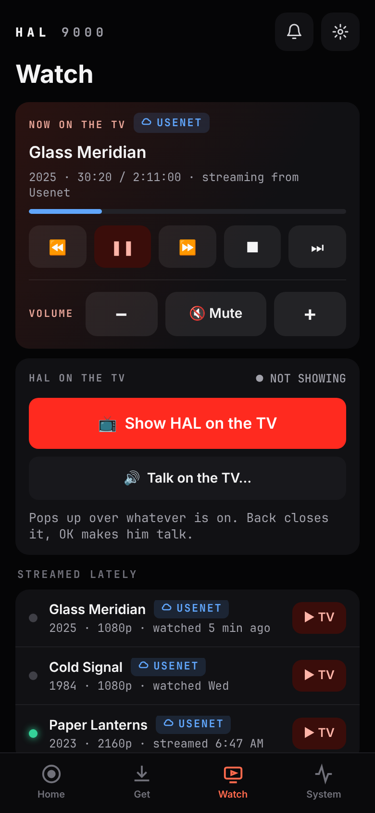

<em>The HAL 9000 phone app: the command center for everything</em>

> *"Good evening, Dave. Everything's running smoothly."*

**HAL 9000 Media Command Center** runs on a Windows PC at home and pulls your downloads, your media, the PC and
the network into one place. Find something, put it on the TV, turn it up, pause the ads, check the drives,
restart a service or lock the PC, all by tap or by voice:

> **"Hey Siri, ask HAL, play Glass Meridian."** HAL finds it, turns the TV on, opens Kodi and picks up where you left off.

**How it came together**
1. **The NZB Command Center**: a Windows desktop app to search Usenet and send downloads to SABnzbd.
2. **A new TV home screen**: we started from the open-source CleanYourTV launcher and built our own home screen on it.
3. **The phone app**, and the **System Command Center** for the PC itself.
4. **HAL 9000** took over: the phone app became his command center, then he got his own screen on the TV, and Siri.
5. **Streaming straight from Usenet**, with no download needed.

---

## Contents

1. [The HAL 9000 phone app](#1-the-hal-9000-phone-app)
2. [Where it started: the NZB Command Center](#2-where-it-started-the-nzb-command-center)
3. [A new home screen for the TV](#3-a-new-home-screen-for-the-tv)
4. [HAL 9000 on the TV](#4-hal-9000-on-the-tv)
5. [Talk to HAL with Siri](#5-talk-to-hal-with-siri)
6. [How it fits together](#how-it-fits-together) · [What you need](#what-you-need) · [Quick start](#quick-start)

---

## 1. The HAL 9000 phone app

This is the command center: everything runs from here. It grew out of the desktop app below into a phone app
with **HAL** at its heart: one calm voice that watches the PC, the drives, your services, the network, Pi-hole,
Uptime Kuma and the UPS, and tells you about your evening in a sentence. It installs to your
home screen from the browser, works at home over Wi-Fi, and anywhere with Tailscale.

**Stream instead of downloading.** Every search result has a **▶ Stream** button next to **+ Add**: it plays on
the TV straight from Usenet (through [AltMount](https://github.com/kipsilabs/altmount)), usually within a minute,
using no disk space. Like what you're watching? One more tap keeps a copy.

  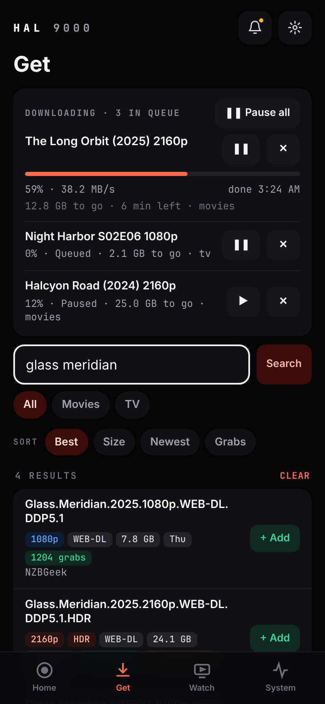
  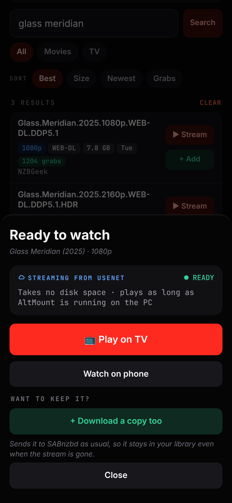
  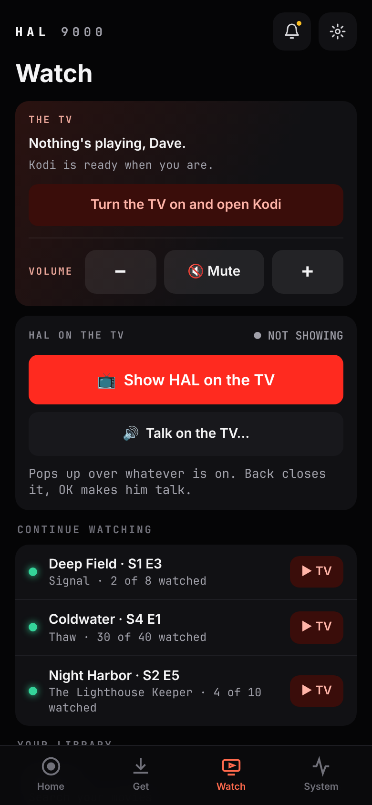

<em>The queue and search · Ready to watch · Watch and the TV remote</em>

- **Find & download**: search every indexer at once, with quality, HDR, size, age and grabs; saved searches run
  by themselves and ping your phone. See what Sonarr and Radarr will fetch next, and find missing episodes.
- **Watch**: play your Kodi library on the TV, resume where you stopped, use the phone as a remote, set the TV's
  volume, turn it on, and see what's playing, even in Netflix or YouTube. Watch on the phone at home through Jellyfin.
- **Look after the PC**: CPU, GPU, temperatures, fans, drives (with "full in about 9 days"), Windows updates,
  Defender, the UPS. Restart a service, lock or sleep the PC, pause Pi-hole for 5 minutes.
- **Alerts** on your phone through ntfy, and a one-line briefing from HAL.

---

## 2. Where it started: the NZB Command Center

It began as one Windows desktop app: a single window to search every Usenet indexer at once, pick the best
release and send it to SABnzbd, then watch it download. It grew tabs for local NZB files, the SABnzbd queue and
history, a Media Inspector for your library, Kodi, and Jellyfin/Plex.

  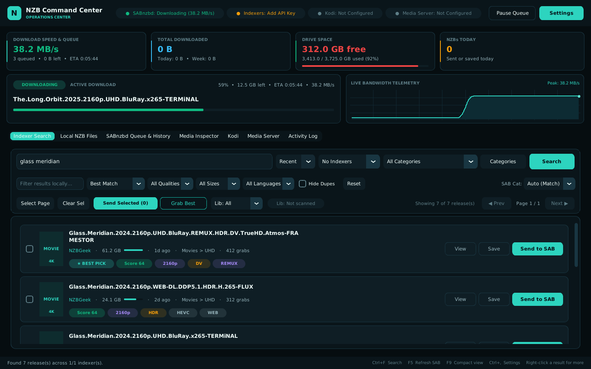

| SABnzbd queue & history | Local NZB files |
|---|---|
| 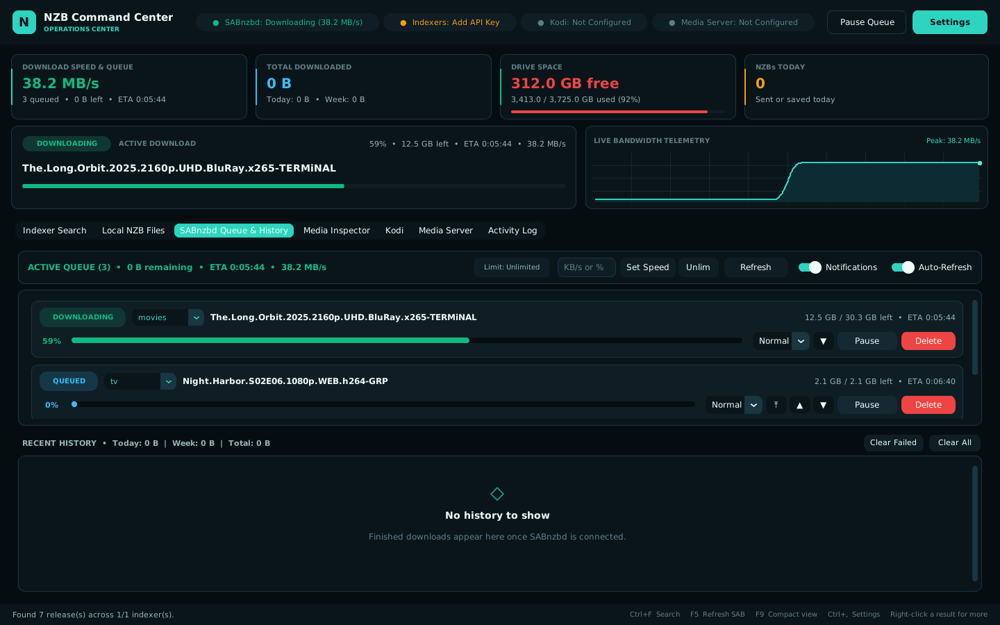 | 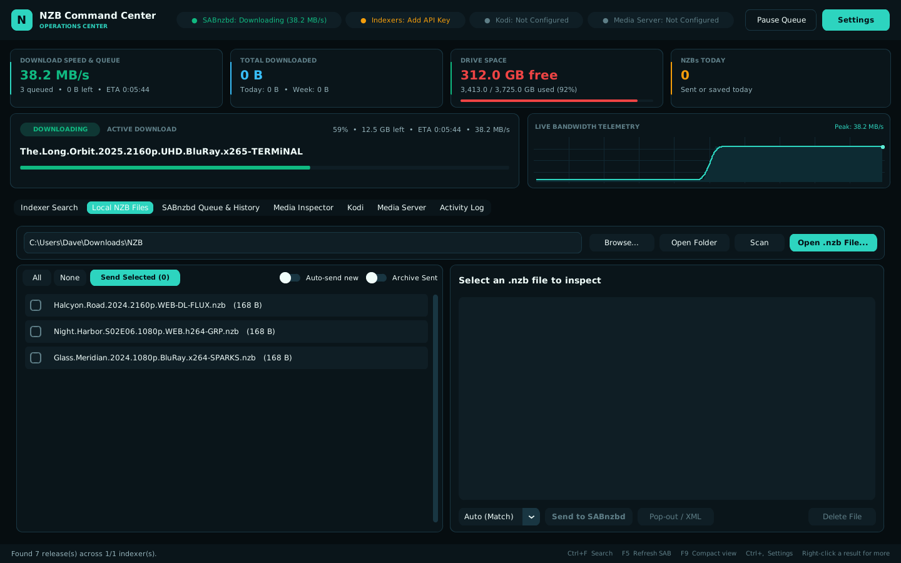 |
| **Media Inspector** | **Kodi** |
| 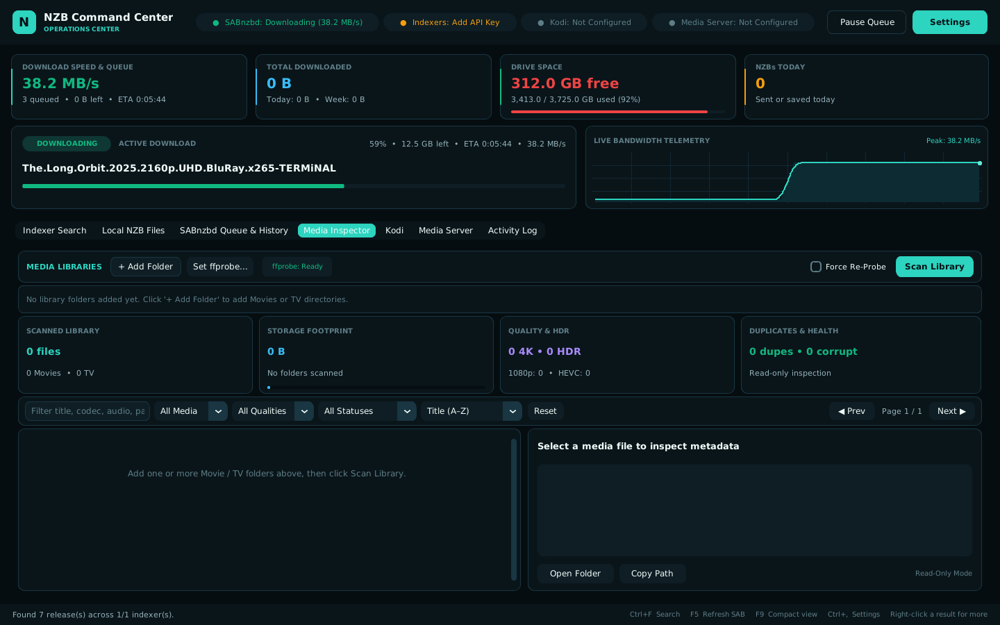 | 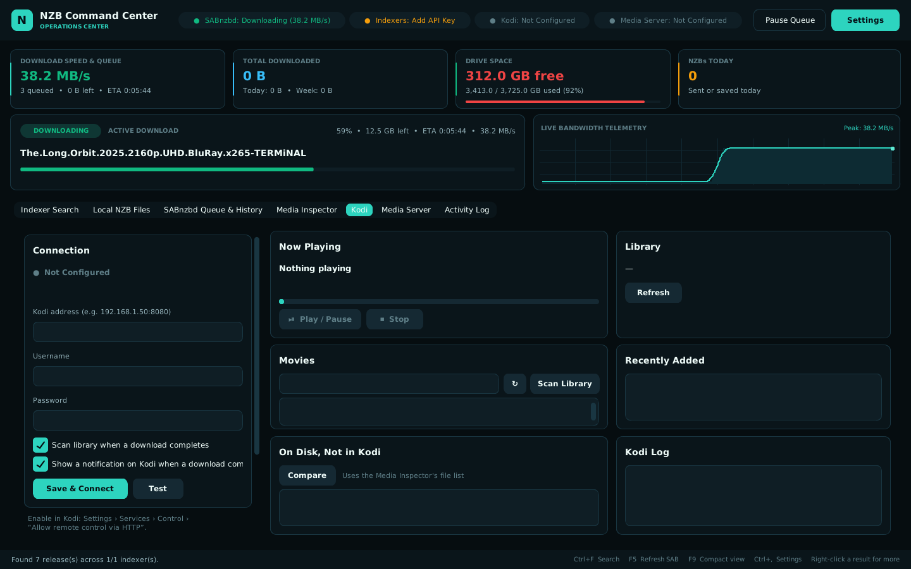 |
| **Jellyfin / Plex** | **System Command Center** (its sister app, for the PC itself) |
| 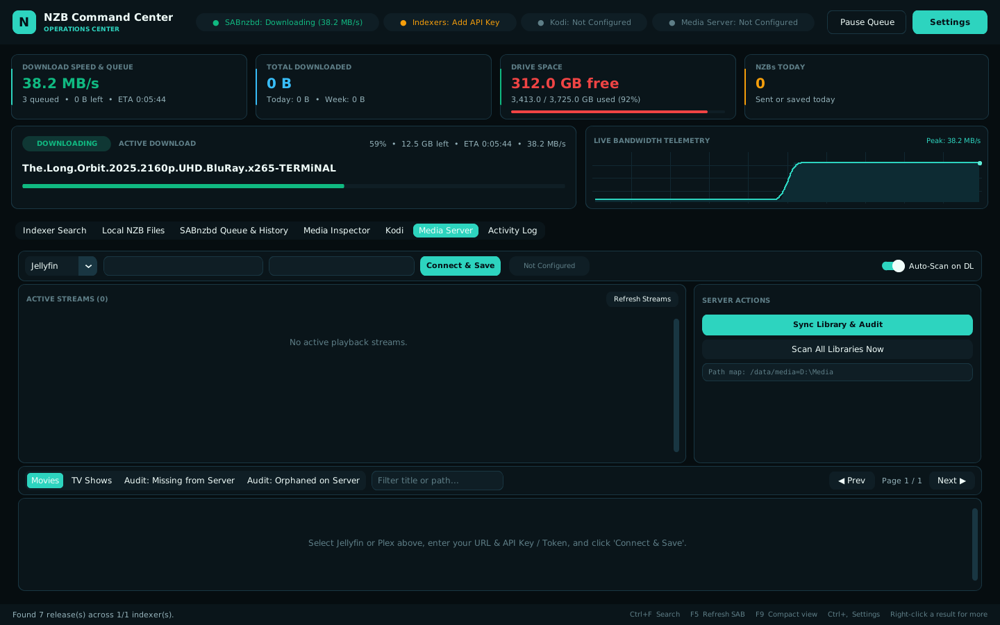 | 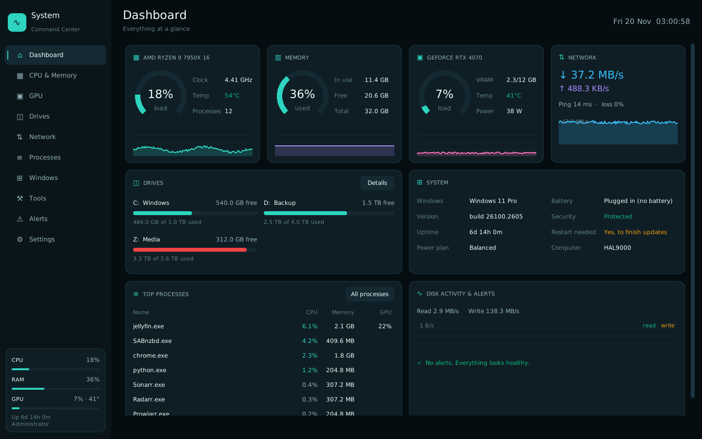 |

---

## 3. A new home screen for the TV

The first thing we did to the TV was throw out its stock home screen, with its ads and promos, and build our
own: an Android TV launcher based on the open-source CleanYourTV, rebuilt around how we actually watch.

  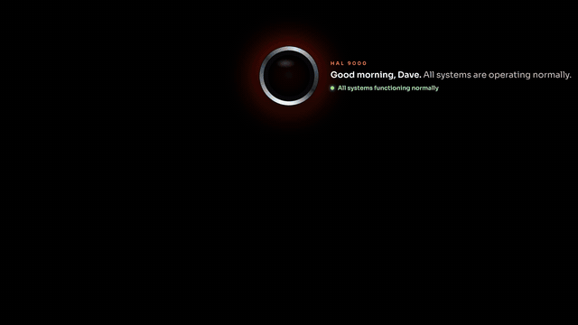

- **HAL right under the top line**: his eye, a greeting, and how everything's doing at a glance. Select him to
  open his full screen.
- **Kodi's "recently watched" shelf**: posters with how far in you are; OK resumes it, even when Kodi isn't running.
- **A clean header**: the time, the date, the weather and an exchange rate.
- **"Ready to watch" cards** when a download finishes, and a **glass dock** with just the apps you use.
- **Screensavers**: your own photo slideshow, or HAL.
- Installed and updated from the PC: **Update everything** in the phone app puts the new version on the TV.

It runs on any Android TV or Google TV device. Most of what's on it comes from the PC, so it's made to go with the
rest of the HAL 9000 Media Command Center. See [tv-launcher/README.md](tv-launcher/README.md).

---

## 4. HAL 9000 on the TV

Open the HAL tile, or tap **Show HAL on the TV** on your phone, and HAL's screen comes up over whatever is on.
He says his line out loud, his eye flares on each word, and the panels around him are live.

  

Press **Down** for a full page each, **Left** and **Right** to move between them:

| The PC | Network |
|---|---|
| 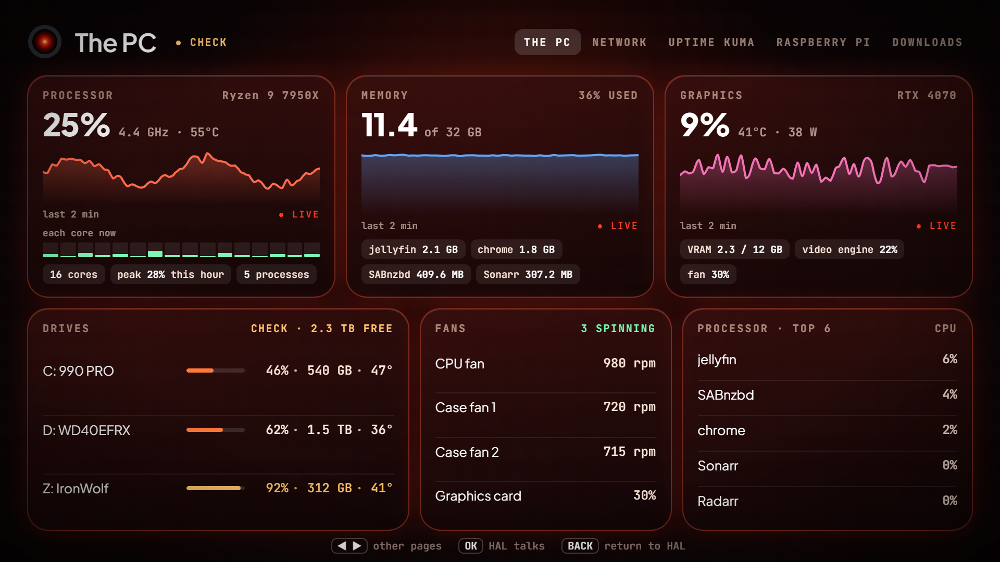 | 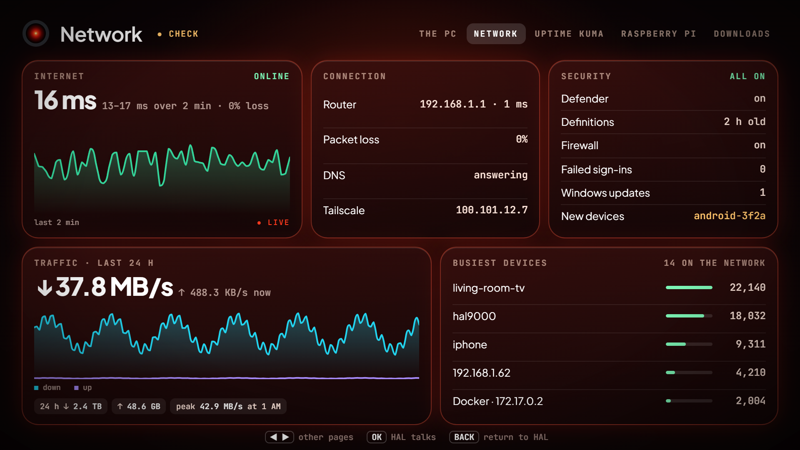 |
| **Uptime Kuma** | **Raspberry Pi & Pi-hole** |
| 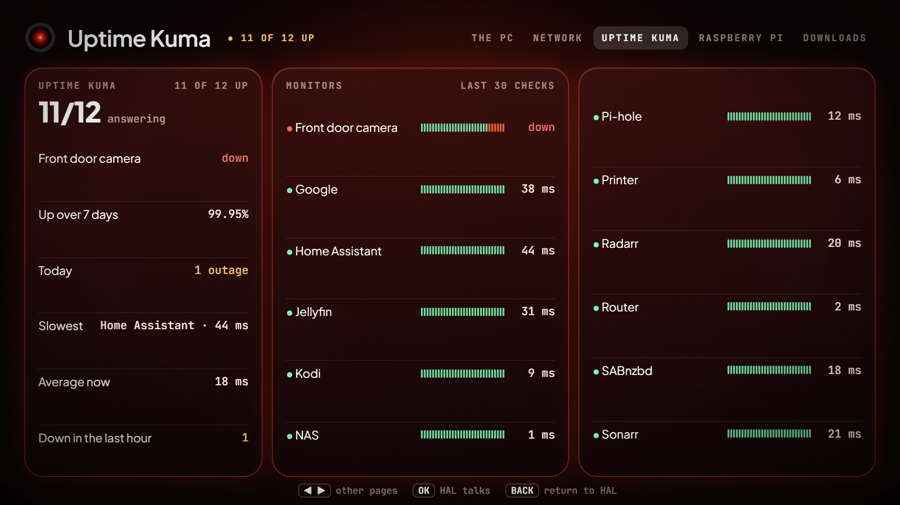 | 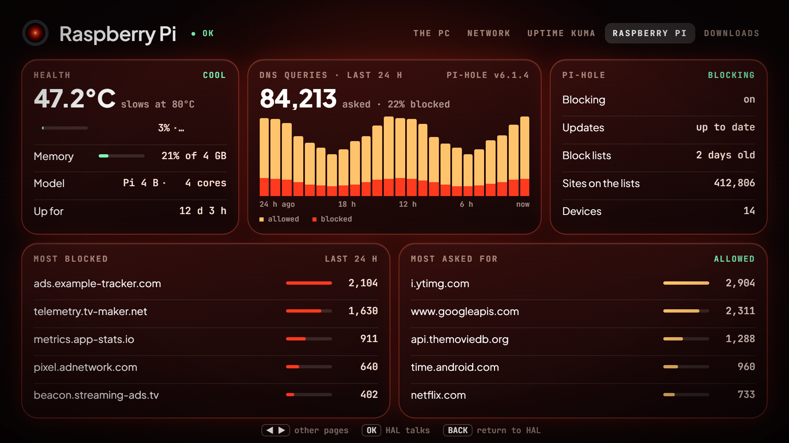 |
| **Downloads** | |
| 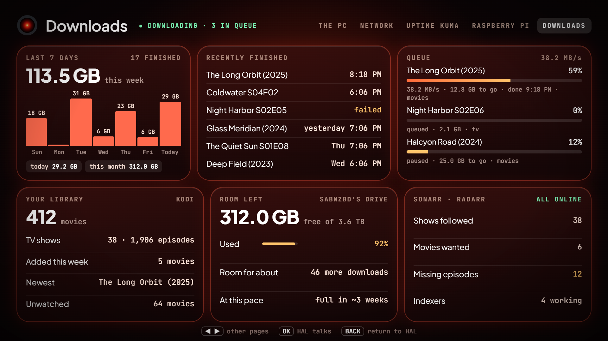 | |

---

## 5. Talk to HAL with Siri

One iPhone Shortcut, and HAL answers out loud. Say **"Hey Siri, ask HAL"**, then:

| Say | HAL |
|---|---|
| "Play Glass Meridian" | Finds it in your Kodi library and plays it on the TV, from where you left off |
| "Play Night Harbor" | A show: the next episode you haven't watched |
| "Turn on the TV and play Deep Field" | TV on, Kodi open, then it plays |
| "Pause" · "Resume" · "Skip ahead" | Controls what's playing |
| "Turn it up" · "Mute" · "TV off" | The TV itself, in any app |
| "Open Netflix" · "Play cat videos on YouTube" | Opens the app on the TV, with the search |
| "How's everything?" | HAL's briefing: the PC, the network, downloads, anything that needs you |

There's a home-screen widget too. Setup takes about five minutes:
[docs/siri-and-widget.md](docs/siri-and-widget.md).

---

## How it fits together

  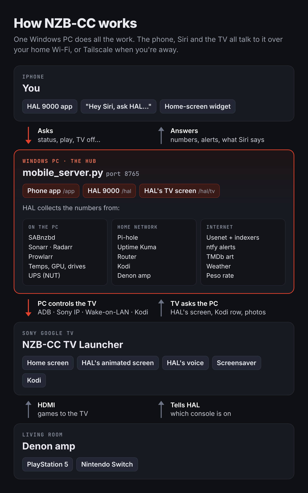

Nothing goes to a cloud service of ours (there isn't one): the phone talks to your PC over your own Wi-Fi, or
Tailscale when you're out, behind an access code.

---

## What you need

**Required**
- A **Windows 10 or 11 PC** that stays on (it runs the server)
- **Python 3.9+** from [python.org](https://www.python.org/downloads/) (tick *Add to PATH*). The only extra package
  is `psutil`, for HAL, and `setup.ps1` installs it for you.
- **SABnzbd**, plus a **Usenet provider** and at least one **indexer**

**Optional: each one switches on more**

| Add this | To get |
|---|---|
| Kodi on the TV | Play on TV, the remote, continue watching, Siri playback |
| AltMount | Stream from Usenet without downloading |
| Sonarr / Radarr / Prowlarr | Upcoming shows and movies, missing episodes |
| Jellyfin | Watch on the phone at home |
| Pi-hole · Uptime Kuma · a NUT-compatible UPS | More for HAL to watch |
| LibreHardwareMonitor | Temperatures and fan speeds |
| ntfy | Alerts on your phone |
| Tailscale | Use it all away from home |
| An Android / Google TV + adb | The new home screen and HAL on the TV |
| An iPhone | "Hey Siri, ask HAL" and the widget |

---

## Quick start

1. **Download** this repo (green **Code** button › *Download ZIP*) and unzip it somewhere permanent, e.g. `C:\HAL9000`.
2. **Run `setup.ps1`** (right-click › *Run with PowerShell*). It starts the phone server, with HAL inside it, when
   Windows starts.
3. **On your phone**, open `http://<your-pc-address>:8765/app/`. Pair it with the 6-digit PIN shown at
   `http://localhost:8765/hal/pair` on the PC, then *Add to Home Screen*.
4. **Connect your services** in the app under **Settings › Connections** (SABnzbd, indexers, Kodi, Pi-hole, …).
   Keys are stored encrypted for your Windows user and never sent to the phone.

Then, if you like:
- **Usenet streaming**: run `try_altmount.ps1`, then `setup_altmount_startup.ps1`. Guide: [docs/usenet-streaming-setup.md](docs/usenet-streaming-setup.md).
- **The TV home screen**: build it and install it with `tv-launcher\install-on-tv.ps1 -TvHost <TV address>`. See [tv-launcher/README.md](tv-launcher/README.md).
- **Siri and the widget**: [docs/siri-and-widget.md](docs/siri-and-widget.md).
- **The desktop apps**: `python nzb_command_center.py` and `python system_command_center.py`.
- **Back up your settings**: `backup_settings.ps1 -Repo https://github.com/<you>/<private-repo>.git` saves them to a
  private repo of your own, with every key and password removed first.

**Updating**: tap **Update everything** in the app (Settings), or run `update_all.ps1`. It fetches the newest
files from this repo, checks them, keeps the old copies in `backup\`, and updates the TV app too.

Every feature and setting is in the full guide: **[docs/GUIDE.md](docs/GUIDE.md)**.

---

## What's in the repo

| File | What it is |
|---|---|
| `mobile_server.py` | The hub: serves the phone app, HAL and the TV screens, and talks to every service |
| `app_page.py`, `mobile_page.py`, `mobile_icons.py` | The phone app's pages |
| `hal_server.py`, `hal_tv_page.py` | HAL 9000: monitoring, alerts, briefings, Siri, and his TV screen (`python hal_server.py --demo` for a look around) |
| `system_monitor.py` | Reads the PC's hardware, drives and Windows details |
| `nzb_command_center.py` + `kodi_client.py`, `media_inspector.py`, `media_server.py` | The NZB Command Center desktop app |
| `system_command_center.py` | The System Command Center desktop app |
| `setup*.ps1`, `update_all.ps1`, `backup_settings.ps1` | Set it up, update it, back up your settings |
| `try_altmount.ps1`, `setup_altmount_startup.ps1`, `play_altmount.ps1` | Usenet streaming with AltMount |
| `tv-launcher/` | The Android TV home screen (source) and the scripts that install it |
| `extras/hal_widget.js` | The iPhone home-screen widget (Scriptable) |
| `tests/` | Tests (`python tests/run_all.py`) |

---

## Privacy & security

- Every request needs your access code, and wrong guesses are rate-limited. By default the server only answers
  your home network and Tailscale.
- API keys and passwords are encrypted with Windows DPAPI and never shown again.
- The only outside calls are the ones you set up: your indexers, ntfy, the weather (Open-Meteo) and artwork (TMDb).
- All screenshots here use demo data.

## Credits & license

- Released under the [MIT License](LICENSE).
- The TV launcher is built on **CleanYourTV** (MIT, see [tv-launcher/LICENSE-cleanyourtv](tv-launcher/LICENSE-cleanyourtv))
  and uses the **Sora** font (OFL) and **Fluent Emoji** icons (MIT).
- HAL 9000 and *2001: A Space Odyssey* belong to their owners. This is a fan tribute for a home setup, and isn't
  affiliated with them.
